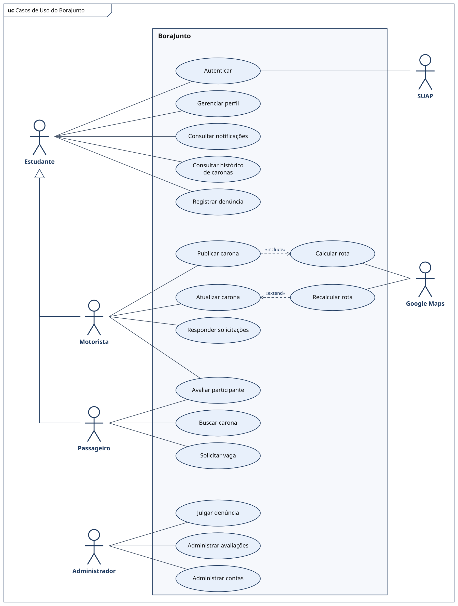
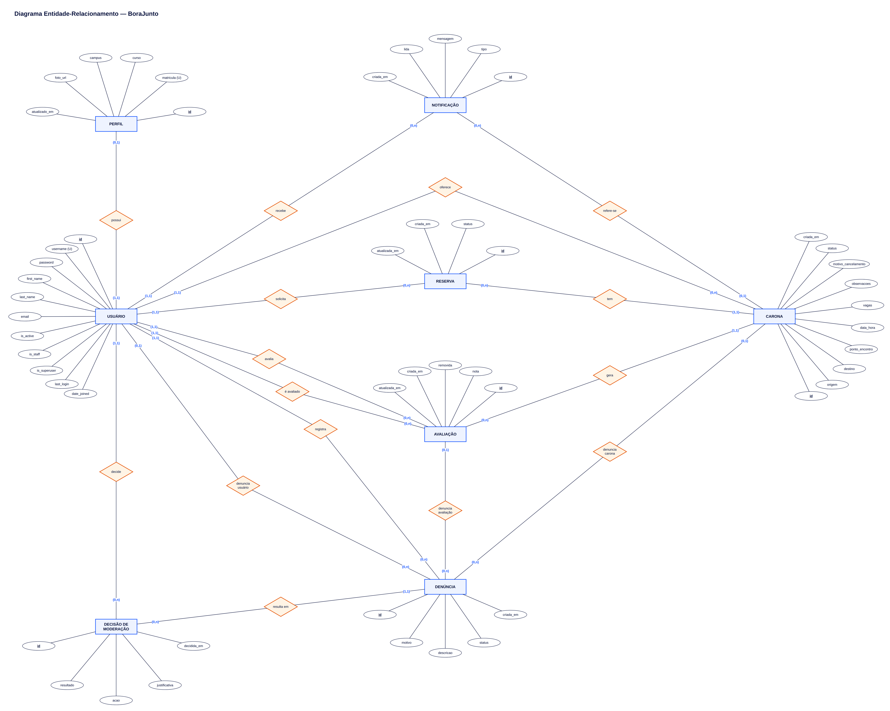
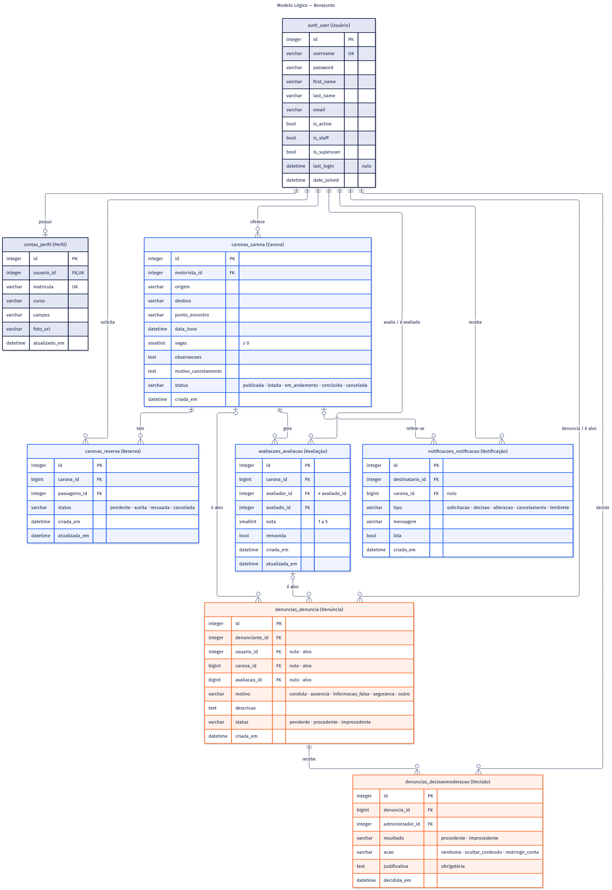
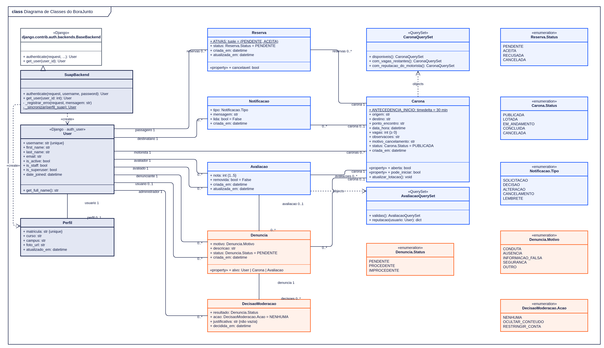

# BoraJunto

Aplicativo web de caronas estudantis, desenvolvido em Django como Projeto Integrador. Estudantes publicam e buscam caronas para a instituição, solicitam vagas, acompanham reservas e veem a rota no Google Maps.

**Equipe:** Almerinda, Kellyson, Klebeson e Matheus
**Orientador:** Prof. Thiago Henrique

## Escopo do MVP

- Login institucional via SUAP
- Publicação, edição e cancelamento de caronas, com rota, distância e duração pelo Google Maps
- Busca por origem, destino e data, e reservas que o motorista aceita ou recusa
- Notificações internas, lembrete 60 minutos antes da carona e histórico
- Avaliação por estrelas a cada carona concluída, com reputação calculada pela média das avaliações
- Denúncias, moderadas pelo Django Admin

Fora do MVP: app móvel nativo, chat, localização em tempo real, pagamentos e notificações push.

## Casos de uso



## Diagrama entidade-relacionamento



Fonte em [`docs/diagrama-er.drawio`](docs/diagrama-er.drawio).

## Modelo lógico



Fonte em [`docs/modelo-logico.drawio`](docs/modelo-logico.drawio).

## Diagrama de classes



Fonte em [`docs/diagrama-de-classes.drawio`](docs/diagrama-de-classes.drawio).

## Como rodar

Requer Python 3.14 e [uv](https://docs.astral.sh/uv/).

```bash
uv sync
uv run python manage.py migrate
uv run python manage.py runserver
```

Os lembretes de 60 minutos antes da carona são gerados por um comando, que deve rodar a cada poucos minutos (por exemplo, no cron):

```bash
*/5 * * * * cd /caminho/do/borajunto && uv run python manage.py enviar_lembretes
```

O login usa a matrícula e a senha do SUAP pela biblioteca [suapy](https://pypi.org/project/suapy/). Para apontar para outra instituição, defina `SUAP_URL`.

## Documentação

- [Documento técnico (PDF)](docs/documento-tecnico.pdf) · [DOCX](docs/documento-tecnico.docx) · [versão online](https://docs.google.com/document/d/1b8KSydmvHhX-QG3A-H45OCtBf2pQ6ZSLaj62nRPDUr4/edit?usp=sharing)
- [Protótipo no Figma](https://www.figma.com/design/U9l4leZCQWGA9rQyVIqIN6/Caronas-Estudantis?node-id=0-1)
