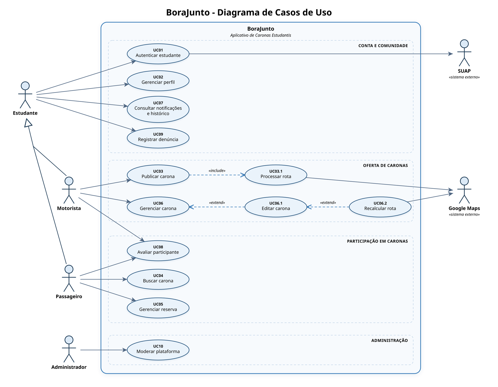

# BoraJunto

Aplicativo web de caronas estudantis, desenvolvido em Django como Projeto Integrador. Estudantes publicam e buscam caronas para a instituição, solicitam vagas, acompanham reservas e veem a rota no Google Maps.

**Equipe:** Almerinda, Kellyson, Klebeson e Matheus
**Orientador:** Prof. Thiago Henrique

## Escopo do MVP

- Login institucional via SUAP
- Publicação, edição e cancelamento de caronas, com rota, distância e duração pelo Google Maps
- Busca por origem, destino e data, e reservas que o motorista aceita ou recusa
- Notificações internas, lembrete 60 minutos antes da carona e histórico
- Avaliação por estrelas após a carona
- Denúncias, moderadas pelo Django Admin

Fora do MVP: app móvel nativo, chat, localização em tempo real, pagamentos e notificações push.

## Casos de uso



## Como rodar

```bash
python -m venv .venv
source .venv/bin/activate
pip install django
python manage.py migrate
python manage.py runserver
```

## Documentação

- [Documento técnico (PDF)](docs/documento-tecnico.pdf) · [versão online](https://docs.google.com/document/d/1b8KSydmvHhX-QG3A-H45OCtBf2pQ6ZSLaj62nRPDUr4/edit?usp=sharing)
- [Protótipo no Figma](https://www.figma.com/design/U9l4leZCQWGA9rQyVIqIN6/Caronas-Estudantis?node-id=0-1)
